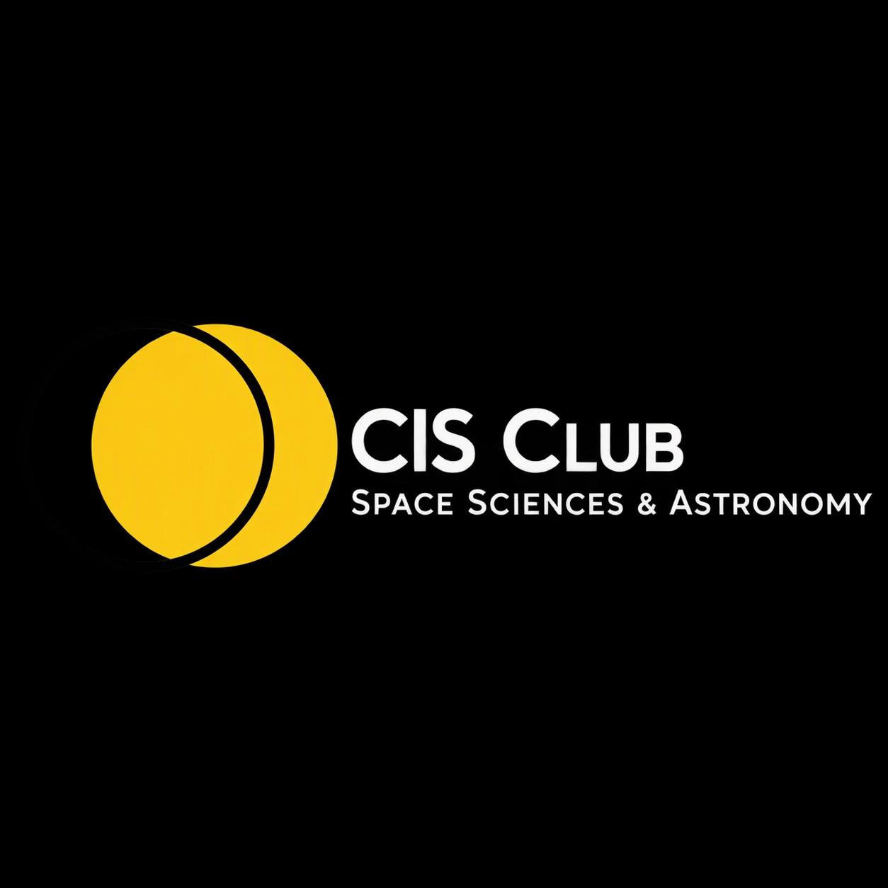
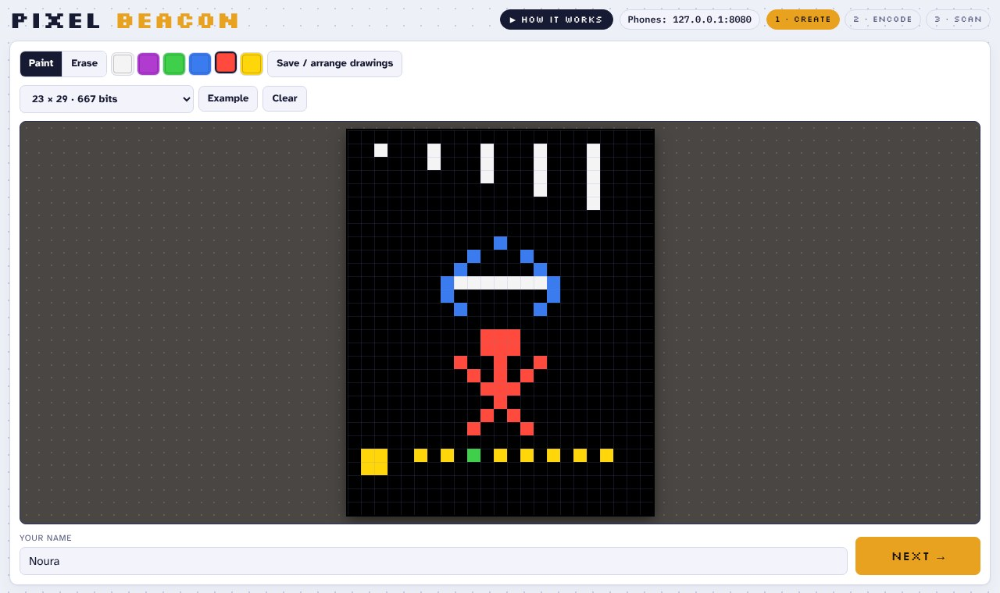
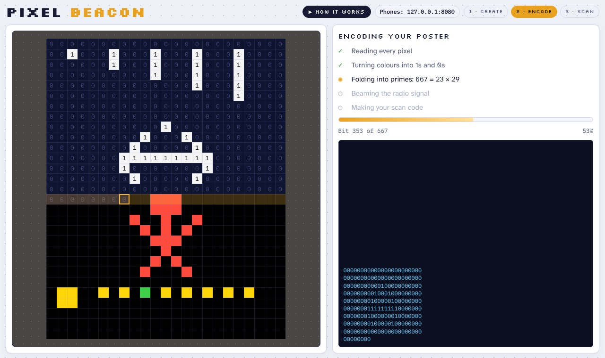
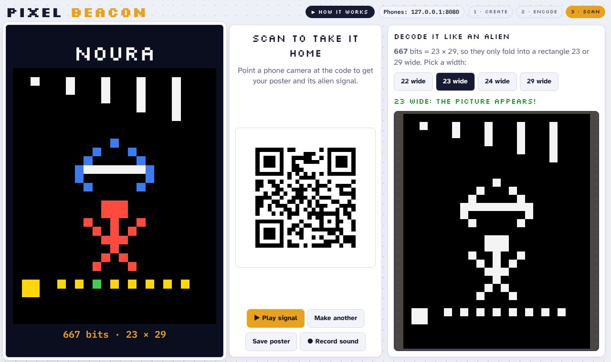
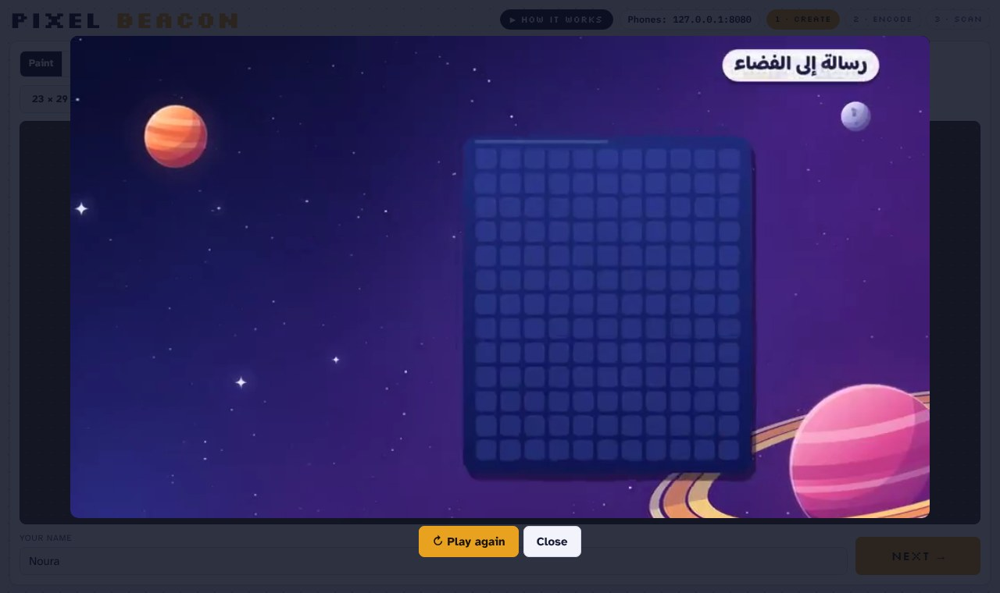
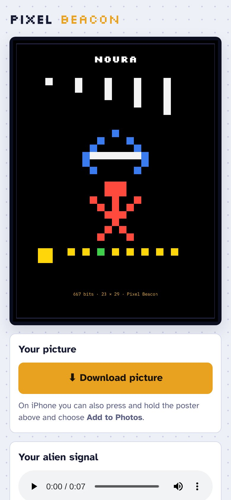
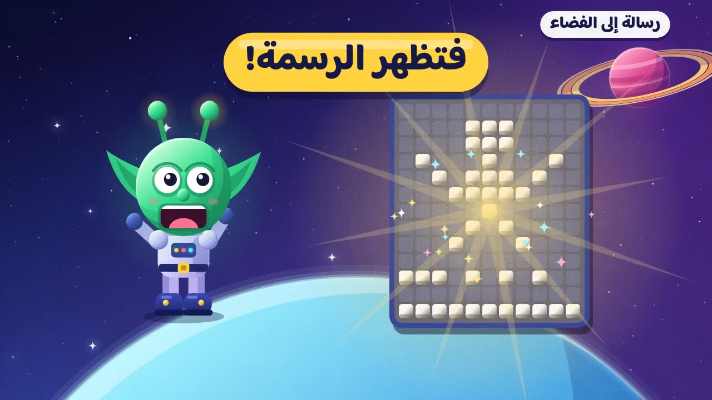

<p align="center">
  
</p>

<h1 align="center">Pixel Beacon</h1>

<p align="center">
  <b>Draw a picture, turn it into 1s and 0s, and beam it to the stars like the 1974 Arecibo message.</b><br>
  An activity by the <b>CIS Club — Space Sciences &amp; Astronomy</b> at <b>Abdullah Al Salem University (AASU)</b>, Kuwait.
</p>

---

## The activity

In 1974 the Arecibo radio telescope sent a message toward a star cluster 25,000 light years away. The message was a picture made of 1,679 on/off pulses. Scientists chose 1,679 because it is **23 × 73**, the product of two primes. A clever listener who counts the pulses can only fold them into a rectangle 23 or 73 wide, and the picture appears.

**Pixel Beacon** lets visitors do the same thing with their own drawing:

1. **Create:** draw pixel art on a grid that is always two primes multiplied (11 × 13, 17 × 19, 23 × 29 or the real Arecibo 23 × 73), then type your name.
2. **Encode:** watch every pixel turn into a 1 or a 0 while the drawing plays as a real two-tone radio signal (a high beep for 1, a low beep for 0).
3. **Scan:** get a poster of your drawing and a QR code. Scan it with your phone to take home the picture and the sound of your alien message.
4. **Decode like an alien:** try different row widths. Only the right prime width rebuilds the picture. The others slant into noise.

It is built for a science-fair booth with kids aged 10 and up. It needs no reading about binary first; they learn by drawing, listening and decoding.

| Create | Encode |
|---|---|
|  |  |
| **Scan** | **How it works (Arabic video)** |
|  |  |

<p align="center"></p>

### What visitors learn

- **Binary:** every picture on a screen is made of numbers. Here each square is one bit: lit = 1, off = 0.
- **Radio signals:** numbers can travel as sound. Pixel Beacon uses frequency-shift keying: 1,320 Hz for a 1 and 880 Hz for a 0.
- **Prime numbers:** why 1,679 = 23 × 73 lets an alien find the right shape without any shared language.
- **The real history:** the Arecibo message, 16 November 1974.

## Booth extras

- **Saved drawings board:** "Save / arrange drawings" keeps each visitor's drawing as a sticker in the frame around the grid. Move, resize and tilt them to build a collage over the day.
- **"How it works" video:** an 18-second Arabic explainer for kids, in the game's header and in [`explainer/`](explainer/).



## Two ways to run it

### 1. Windows booth app (recommended for events)

A single `PixelBeacon.exe` that runs on the booth laptop with no internet. It opens the game in the browser, saves every poster as a **PNG** and a **WAV** sound in a `PixelBeacon-posters` folder, and serves a phone page with real **Download picture** and **Download sound** buttons.

1. Build it (see below) or take `PixelBeacon-windows.zip` from the Releases page if one is published.
2. Double-click `PixelBeacon.exe`. Allow it on **Private networks** when Windows Firewall asks.
3. Phones must be on the **same Wi-Fi** as the laptop. Event Wi-Fi often blocks this, so the laptop's own **Mobile hotspot** is the safest choice. Click **Phones:** in the header to pick the address and add the hotspot name and password; a "Join Wi-Fi" QR code then appears next to every poster code.

Full booth instructions: [`app/README-booth.txt`](app/README-booth.txt).

### 2. Single-file web version

[`game/pixel-beacon.html`](game/pixel-beacon.html) is the whole game in one file, built as a Claude artifact. Drawing, encoding, sound and decoding work in any browser. Sharing posters to phones uses the Claude artifact storage, so outside Claude the QR step needs the Windows app.

## Building

**Windows app** (needs Go 1.24+ and Python 3):

```bash
cd app
python3 build_booth.py          # regenerates web/booth.html from game/pixel-beacon.html
GOOS=windows GOARCH=amd64 go build -trimpath -ldflags "-s -w" -o dist/PixelBeacon/PixelBeacon.exe .
```

Run `go run .` instead to try it on macOS or Linux.

**Explainer video** (needs Node, Playwright and ffmpeg):

```bash
cd explainer
npm i @fontsource/baloo-bhaijaan-2@5 @fontsource/nunito@5 playwright
python3 build.py                # builds storyboard.html and pixel-beacon-explainer.html
mkdir -p out && node render.js out
ffmpeg -i out/video.tmp.mp4 -f s16le -ar 48000 -ac 2 -i out/audio.raw \
  -map 0:v -map 1:a -c:v copy -c:a aac -b:a 192k -shortest pixel-beacon-explainer.mp4
```

The timeline lives in `explainer/explainer.js` (`TL`), and the sound effects are generated in code in `scoreSound`.

## Repository layout

```
game/        the single-file game (HTML)
app/         Windows booth app (Go server + generated booth page, fonts, explainer video)
explainer/   the Arabic explainer video: source, player page, storyboard, rendered MP4
docs/        logo and screenshots for this README
```

## Credits

Made by the **CIS Club — Space Sciences & Astronomy**, Abdullah Al Salem University (AASU), Kuwait.

- Inspired by the 1974 Arecibo message (Frank Drake, Carl Sagan and the Arecibo Observatory team).
- Fonts: Silkscreen, Atkinson Hyperlegible, IBM Plex Mono, Baloo Bhaijaan 2 and Nunito, all under the SIL Open Font License.
- QR codes: [qrcode-generator](https://github.com/kazuhikoarase/qrcode-generator) by Kazuhiko Arase (MIT License).

Code is released under the [MIT License](LICENSE). The CIS Club logo belongs to the club and is not covered by that license.
